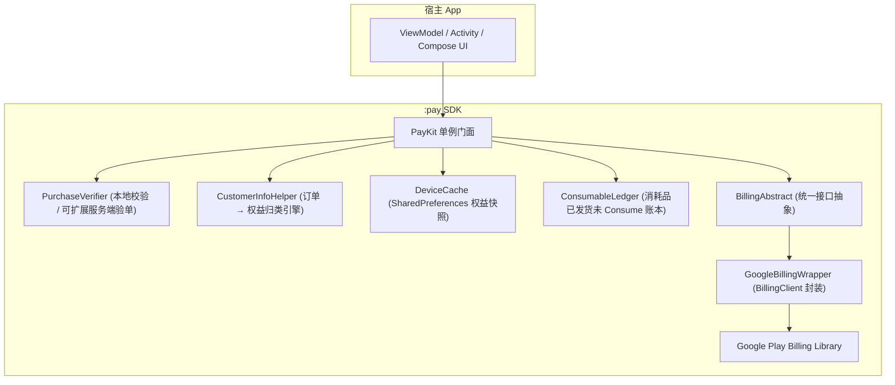
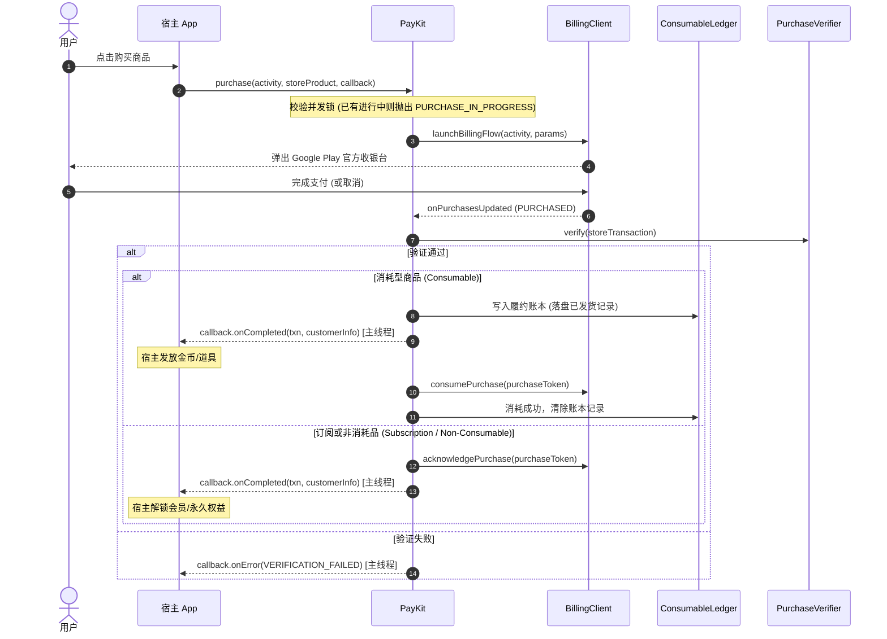

# PayKit-Android

[](https://github.com/e-hai/PayKit-Android/releases/tag/1.0.0)
[](https://github.com/e-hai/PayKit-Android/packages)
[](https://developer.android.com)
[](https://kotlinlang.org)
[](https://developer.android.com/google/play/billing)
[](LICENSE)

**PayKit-Android** 是一个专为 Android 打造的高可靠、轻量级 Google Play 支付 SDK。采用现代 Kotlin 协程架构，全面封装 Google Play Billing Library，支持纯本地无后端快速接入，同时保留服务端验单与跨端对齐扩展能力。

---

## 🌟 核心特性

- **现代协程 API**：全面拥抱 Kotlin Coroutines（`suspend` 挂起函数），告别传统 Billing 复杂的多层异步回调地狱。
- **纯本地极速接入**：无需自建鉴权后端，SDK 内置权益计算引擎，开箱即用计算订阅与内购有效状态。
- **冷启动秒开快照**：基于 `DeviceCache` 的本地持久化权益缓存，App 启动首屏零延迟立即可用。
- **防掉单履约账本**：针对消耗品（金币/道具）内置 `ConsumableLedger`，发货未 consume 先落盘。应对网络断开、App 强退或进程崩溃，自动在下次启动时对账补单。
- **并发购买安全防护**：内置单笔交易互斥锁，多重点击自动拦截并返回 `PURCHASE_IN_PROGRESS`，杜绝重复扣款与事务覆盖。
- **订阅全周期支持**：完整支持新一代 Google Play 基础方案（Base Plan）与优惠方案（Offers），支持订阅换档与升降级（`SubscriptionReplacement`）。
- **插拔式验单扩展**：默认采用 `LocalPurchaseVerifier` 快速上线；生产环境可一键注入自定义 `PurchaseVerifier` 对接自有服务端校验。
- **主线程安全调度**：所有面向 UI 的监听器与回调（`PurchaseCallback`、`UpdatedCustomerInfoListener`）均自动在主线程派发，直接安全更新 UI。

---

## 🏗️ 架构与数据流

### 模块分层架构



### 购买核心时序



---

## 📦 集成方式

### 方式一：GitHub Packages（推荐）

> 💡 **从 JitPack 迁移提示**：依赖坐标保持 `com.github.e-hai:PayKit-Android:<version>` 不变！只需将仓库源从 `jitpack.io` 替换为 GitHub Packages 并配置 GitHub Token 即可，业务模块代码与依赖声明无需更改。

#### 1. 配置 GitHub 读取凭证

由于 GitHub Packages 下载 Maven 依赖强制要求身份鉴权（即使仓库公开），接入方需先生成具备 `read:packages` 权限的 Token：

1. 前往 GitHub **Settings $\rightarrow$ Developer settings $\rightarrow$ Personal access tokens $\rightarrow$ Tokens (classic)**。
2. 点击 **Generate new token (classic)**，勾选 **`read:packages`** 权限并生成 Token。
3. 在**本机全局** `~/.gradle/gradle.properties` 中写入以下两行（推荐写在用户目录下，避免误提交到版本库）：

```properties
gpr.user=你的GitHub用户名
gpr.key=ghp_你的PersonalAccessToken
```

> CI/CD 构建环境（如 GitHub Actions）也可以直接通过环境变量 `GITHUB_ACTOR`（或 `GITHUB_USER`）与 `GITHUB_TOKEN` 传入，无需写入文件。

#### 2. 配置仓库源 (`settings.gradle.kts`)

在项目根目录 `settings.gradle.kts` 中加入 GitHub Packages Maven 仓库：

```kotlin
dependencyResolutionManagement {
    repositoriesMode.set(RepositoriesMode.FAIL_ON_PROJECT_REPOS)
    repositories {
        google()
        mavenCentral()
        maven {
            name = "GitHubPackages"
            url = uri("https://maven.pkg.github.com/e-hai/PayKit-Android")
            credentials {
                username = providers.gradleProperty("gpr.user")
                    .orElse(providers.environmentVariable("GITHUB_USER"))
                    .orElse(providers.environmentVariable("GITHUB_ACTOR"))
                    .orNull
                password = providers.gradleProperty("gpr.key")
                    .orElse(providers.environmentVariable("GITHUB_TOKEN"))
                    .orNull
            }
        }
    }
}
```

<details>
<summary>如果你的凭证放在项目本地 <code>local.properties</code> 中（点击展开写法）</summary>

```kotlin
import java.util.Properties

val localProps = Properties().apply {
    val file = rootDir.resolve("local.properties")
    if (file.exists()) file.inputStream().use(::load)
}

dependencyResolutionManagement {
    repositoriesMode.set(RepositoriesMode.FAIL_ON_PROJECT_REPOS)
    repositories {
        google()
        mavenCentral()
        maven {
            name = "GitHubPackages"
            url = uri("https://maven.pkg.github.com/e-hai/PayKit-Android")
            credentials {
                username = providers.gradleProperty("gpr.user").orNull
                    ?: localProps.getProperty("gpr.user")
                    ?: System.getenv("GITHUB_USER")
                    ?: System.getenv("GITHUB_ACTOR")
                password = providers.gradleProperty("gpr.key").orNull
                    ?: localProps.getProperty("gpr.key")
                    ?: System.getenv("GITHUB_TOKEN")
            }
        }
    }
}
```

</details>

#### 3. 添加依赖

在应用模块（如 `app/build.gradle.kts`）中添加依赖：

```kotlin
dependencies {
    implementation("com.github.e-hai:PayKit-Android:1.0.0")
}
```

如果使用 Gradle Version Catalog（`gradle/libs.versions.toml`）：

```toml
[versions]
paykit = "1.0.0"

[libraries]
paykit = { group = "com.github.e-hai", name = "PayKit-Android", version.ref = "paykit" }
```

> **注意**：SDK 已传递引入官方 `com.android.billingclient:billing-ktx` 与清单权限 `<uses-permission android:name="com.android.vending.BILLING" />`，宿主无需重复声明。

---

### 方式二：本地子模块源码集成

将 `:pay` 模块放入您的 Android 项目中，在 `settings.gradle.kts` 引入 `include(":pay")`，随后在应用模块中引入：

```kotlin
dependencies {
    implementation(project(":pay"))
}
```

---

## 🚀 快速上手

### 1. 配置商品分类与初始化

在您的 `Application.onCreate` 中初始化 `PayKit`（确保在主线程调用）：

```kotlin
object ProductIds {
    const val SUBS_PLUS = "subs_plus"
    const val SUBS_PRO = "subs_pro"
    const val COINS_100 = "coins_100"
    const val COINS_500 = "coins_500"
    const val LIFETIME_PASS = "lifetime_pass"

    val CONSUMABLES = setOf(COINS_100, COINS_500)
}

class MyApplication : Application() {
    override fun onCreate() {
        super.onCreate()
        initPayKit()
    }

    private fun initPayKit() {
        // 声明商品分类（必须与 Google Play Console 后台创建的 ID 一致）
        val configuration = PayKitConfiguration(
            // 订阅商品 ID (自动执行 Acknowledge)
            subsProductIds = setOf(ProductIds.SUBS_PLUS, ProductIds.SUBS_PRO),
            // 消耗型商品 ID (自动入账并在发货后执行 Consume)
            consumableProductIds = ProductIds.CONSUMABLES,
            // 非消耗型永久商品 ID (自动执行 Acknowledge)
            nonConsumableProductIds = setOf(ProductIds.LIFETIME_PASS)
        )

        // 配置并启动连接
        PayKit.configure(this, configuration)

        // 注册全局权益变化监听（可选，回调运行在主线程）
        PayKit.shared.setUpdatedCustomerInfoListener(object : UpdatedCustomerInfoListener {
            override fun onReceived(customerInfo: CustomerInfo) {
                val hasPro = ProductIds.SUBS_PRO in customerInfo.activeSubscriptions
                val hasLifetime = ProductIds.LIFETIME_PASS in customerInfo.nonConsumablePurchases
                Log.d("PayKit", "用户权益更新: Pro=$hasPro, Lifetime=$hasLifetime")
            }
        })
    }
}
```

---

### 2. 查询商品详情与展示价格

在展示购买页面前，调用 `getProducts` 获取带本地币种符号的展示价格与优惠信息：

```kotlin
viewModelScope.launch {
    val productIds = setOf(ProductIds.SUBS_PRO, ProductIds.COINS_100, ProductIds.LIFETIME_PASS)
    val result = PayKit.shared.getProducts(productIds)

    result.onSuccess { products: List<StoreProduct> ->
        for (product in products) {
            Log.d("PayKit", "商品ID: ${product.productId}")
            Log.d("PayKit", "标题: ${product.title}")
            Log.d("PayKit", "格式化价格: ${product.price}") // 如 "$4.99" 或 "¥30.00"
            Log.d("PayKit", "是否有免费试用: ${product.hasFreeTrial}")
        }
    }.onFailure { error ->
        Log.e("PayKit", "查询商品失败: ${error.message}")
    }
}
```

---

### 3. 发起购买流程

在 Activity 中调起支付（支持单次内购、订阅及消耗品）：

```kotlin
fun onBuyClicked(activity: Activity, product: StoreProduct) {
    PayKit.shared.purchase(
        activity = activity,
        storeProduct = product,
        callback = object : PurchaseCallback {
            override fun onCompleted(
                storeTransaction: StoreTransaction,
                customerInfo: CustomerInfo
            ) {
                // 支付成功！回调运行在主线程
                Log.d("PayKit", "购买成功，订单号: ${storeTransaction.orderId}")

                if (product.productId in ProductIds.CONSUMABLES) {
                    // 1. 若为消耗型商品，在此处给用户发货（发放金币/道具）
                    grantVirtualCurrency(product.productId)
                    // SDK 会在后台自动完成 consume 并清理账本；若网络故障未完成，下次启动时会自动补单
                } else {
                    // 2. 订阅或非消耗品，SDK 已自动完成 Acknowledge 确认
                    updateUserVipStatus(customerInfo)
                }
            }

            override fun onPending(storeTransaction: StoreTransaction) {
                // 等待支付确认（如现金充值/便利店支付/银行转账），切勿此时发货
                Log.d("PayKit", "交易待支付确认，订单号: ${storeTransaction.orderId}")
                Toast.makeText(activity, "支付处理中，请稍候...", Toast.LENGTH_SHORT).show()
            }

            override fun onError(error: PayKitError, userCancelled: Boolean) {
                // 购买异常或取消
                if (userCancelled) {
                    Log.d("PayKit", "用户取消了支付")
                } else {
                    Log.e("PayKit", "支付异常: ${error.message} [${error.code}]")
                }
            }
        }
    )
}
```

---

### 4. 获取用户当前权益（冷启动秒开）

```kotlin
viewModelScope.launch {
    // 方式 A：只读本地缓存（首屏秒开，零网络延迟）
    val cachedInfo: CustomerInfo? = PayKit.shared.getCustomerInfo(forceSync = false)
    val isVip = cachedInfo?.activeSubscriptions?.contains(ProductIds.SUBS_PRO) == true

    // 方式 B：强制从 Google Play 商店后台对账同步（默认）
    val freshInfo: CustomerInfo? = PayKit.shared.getCustomerInfo(forceSync = true)
}
```

---

### 5. 恢复购买与同步

Google Play 官方无需用户输入密码单独恢复购买，只需调用 `restorePurchases()` 即可自动对账并激活权益：

```kotlin
fun onRestorePurchasesClicked() {
    viewModelScope.launch {
        PayKit.shared.restorePurchases()
            .onSuccess { info ->
                Toast.makeText(context, "购买已恢复: ${info.activeSubscriptions}", Toast.LENGTH_SHORT).show()
            }
            .onFailure { error ->
                Toast.makeText(context, "恢复失败: ${error.message}", Toast.LENGTH_SHORT).show()
            }
    }
}
```

---

### 6. 消耗品启动补单（防掉单机制）

当用户购买消耗型商品并支付成功后，若遇 App 崩溃、进程被系统强杀或网络闪断导致未能及时完成发货，PayKit 的 `ConsumableLedger` 会记录未履约订单。

可在启动后检查并进行补偿发货：

```kotlin
viewModelScope.launch {
    val info = PayKit.shared.getCustomerInfo(forceSync = true) ?: return@launch

    // 遍历所有待发货的消耗品记录
    for (unfulfilled in info.unfulfilledConsumables) {
        val token = unfulfilled.purchaseToken
        Log.w("PayKit", "发现未履约消耗品订单: ${unfulfilled.orderId}, 商品: ${unfulfilled.productIds}")

        // 1. 业务发货逻辑
        val success = deliverItemToUser(unfulfilled.productIds)
        if (success) {
            // 2. 标记履约完成，通知 SDK 销毁账本并 Consume 释放商品
            PayKit.shared.markConsumableFulfilled(token)
        }
    }
}
```

---

### 7. 订阅升降级与换档

如需在同一订阅组内换档或从月付升级到年付，传入 `SubscriptionReplacement`（使用 PayKit 封装的 `SubscriptionReplacementMode`，无需依赖底层 Billing 类）：

```kotlin
val activeSub = PayKit.shared.findActiveSubscription(ProductIds.SUBS_PLUS)
if (activeSub != null) {
    val replacement = SubscriptionReplacement(
        oldProductId = ProductIds.SUBS_PLUS,
        oldPurchaseToken = activeSub.purchaseToken,
        replacementMode = SubscriptionReplacementMode.CHARGE_FULL_PRICE
    )

    PayKit.shared.purchase(
        activity = activity,
        storeProduct = newProProduct,
        callback = callback,
        subscriptionReplacement = replacement
    )
}
```

---

### 8. 服务端验单扩展（可选）

默认使用纯本地校验。如需在发货前将收据提交至自有服务器验签：

```kotlin
PayKit.shared.setPurchaseVerifier(PurchaseVerifier { txn: StoreTransaction ->
    try {
        // 调用您的服务端 HTTP 接口验签
        val response = myApiService.verifyGooglePurchase(
            orderId = txn.orderId,
            purchaseToken = txn.purchaseToken,
            productIds = txn.productIds,
            signature = txn.signature,
            originalJson = txn.originalJson
        )
        if (response.isSuccess) {
            Result.success(Unit)
        } else {
            Result.failure(PayKitError(ErrorCode.VERIFICATION_FAILED, "服务端验单未通过"))
        }
    } catch (e: Exception) {
        Result.failure(PayKitError(ErrorCode.NETWORK_ERROR, "验单网络超时"))
    }
})
```

---

## 🧪 Google Play 沙盒与测试指南

不同于 iOS 的离线 `.storekit` 文件，Google Play Billing 依赖设备上的 Google Play 商店服务（`com.android.vending`）与云端通信。完整测试流程如下：

### 1. 前置准备（仅需配置一次）
1. **开发者账号**：在 [Google Play Console](https://play.google.com/console) 创建应用。应用包名（`applicationId`）须与代码完全一致。
2. **首次上传 AAB**：给应用打一个 Release 签名包上传到 **内部测试（Internal Testing）** 轨道（内部测试无需等待 Google 官方人工审核，仅用于注册应用元数据与签名）。
3. **创建商品与基础方案**：
   - 在 Play Console 侧边栏的 **“创收” $\rightarrow$ “商品”** 中创建订阅或应用内商品。
   - 订阅商品须至少包含一个已激活的 **Base Plan（基础方案）**。
4. **配置许可测试人员（License Testers）**：
   - 前往 **Play Console $\rightarrow$ 设置 $\rightarrow$ 许可测试（License testing）**。
   - 添加您的测试 Gmail 账号。
   - “许可响应”选择 `RESPOND_NORMALLY`。
   - “测试购买”选择 **“测试卡，始终批准”**（测试时不扣除真实费用）。

### 2. 本地开发与联调
- 在安装有 Google Play 服务的真机或模拟器上，登录已加入许可测试的 Gmail 账号。
- **直接通过 Android Studio 点击 Run/Debug 安装调试 APK**（只要包名与上传的 AAB 一致，即可直接本地联调）。
- 调起购买时，系统弹窗将带有 **“这是测试订单，不会向你收费”** 提示。
- **订阅周期加速测试**：测试沙盒中订阅会自动缩短（例如 1 个月订阅缩短为每 5 分钟自动续费一次，最多续费 6 次后自动取消）。

### 3. 官方辅助工具：Play Billing Lab
推荐在测试设备上通过 Google Play 商店安装官方提供的 **Play Billing Lab** 应用。可在不改动代码的情况下模拟：
- 重置免费试用资格
- 模拟扣款失败（Payment Declines）与宽限期（Grace Period）
- 跨国家/地区与本地化货币定价测试

---

## 🚀 发布与自动化 CI/CD（维护者）

本项目通过 GitHub Actions 自动完成单测验证与 GitHub Packages 发布（配置见 [`.github/workflows/publish.yml`](file:///Users/a/Develop/project/android/PayKit-Android/.github/workflows/publish.yml)）：

- **推送 Tag 自动发布**：推送语义化版本 Tag（如 `1.0.1` 或 `v1.0.1`，注意同一版本只推一种格式避免冲突）即可自动触发 CI 运行单元测试并发布 AAR 至 GitHub Packages。
- **Actions 页面手动发布**：在 GitHub 仓库 **Actions $\rightarrow$ Publish to GitHub Packages $\rightarrow$ Run workflow** 中输入目标版本号即可手动发版（如补发 `1.0.0`）。
- **本地验证产物**：
  ```bash
  ./gradlew :pay:publishToMavenLocal
  ```

---

## 🛡️ 混淆规则 (ProGuard / R8)

SDK 已内置 AAR 混淆消费规则（[`consumer-rules.pro`](file:///Users/a/Develop/project/android/PayKit-Android/pay/consumer-rules.pro)），宿主开启 `minifyEnabled = true` 时会自动保留所需模型与接口，无需额外手动配置。规则如下：

```proguard
-keep class com.kit.pay.PayKit { *; }
-keep class com.kit.pay.models.** { *; }
-keep class com.kit.pay.interfaces.** { *; }
-keepclassmembers class * implements com.kit.pay.interfaces.PurchaseCallback { *; }
-keepclassmembers class * implements com.kit.pay.interfaces.UpdatedCustomerInfoListener { *; }
-keep class com.android.billingclient.api.** { *; }
-dontwarn com.android.billingclient.api.**
```

---

## 📊 数据模型与错误码

### CustomerInfo
```kotlin
data class CustomerInfo(
    val activeSubscriptions: Set<String>,            // 当前生效中的订阅商品 ID 集合
    val nonConsumablePurchases: Set<String>,         // 永久拥有的非消耗品商品 ID 集合
    val allPurchaseRecords: List<StoreTransaction>,  // 当前商店可见交易快照
    val unfulfilledConsumables: List<StoreTransaction> // 待发货的消耗品列表
)
```

### ErrorCode 错误枚举
| 错误码 | 说明 | 应对建议 |
|---|---|---|
| `PURCHASE_CANCELLED` | 用户主动取消支付 | 无需特殊处理，界面恢复即可 |
| `PURCHASE_IN_PROGRESS` | 已有一笔购买在进行中 | 防止用户暴力多击，忽略或轻提示 |
| `ITEM_ALREADY_OWNED` | 商品已拥有 | 引导用户恢复购买或执行升降级换档 |
| `PRODUCT_NOT_AVAILABLE`| 商品未找到或未激活 | 检查 Console 后台商品 ID、Base Plan 状态及发布轨道 |
| `STORE_PROBLEM` | Google Play 商店内部服务错误 | 提示用户稍后重试或检查 Play 商店更新 |
| `VERIFICATION_FAILED` | 自定义验单未通过 | 提示订单校验失败，检查服务端签名配置 |
| `NETWORK_ERROR` | 网络不可用 | 提示用户检查网络连接 |

---

## 🛠️ 构建与环境要求

- **Min SDK**: 21 (Android 5.0+)
- **Compile SDK**: 37
- **Target SDK**: 35 / 36 / 37
- **Kotlin**: 2.3+ / 2.4+
- **Gradle**: 9.8.2+
- **AGP**: 9.1.0+ / 9.1.1+
- **JDK**: Java 17+ (兼容 Java 25 / JBR 25)

---

## 📄 License

```
MIT License

Copyright (c) 2026 PayKit Open Source Project
```
