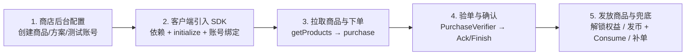

# PayKit 全链路接入 SOP（商店后台配置 → SDK 接入 → 支付发货）

本文档梳理了从 **Google Play Console / App Store Connect 创建商品**，到 **接入 `PayKit 1.1.0`（Android & iOS）**，再到 **用户支付成功、验单确认、发放商品与异常兜底** 的完整标准作业流程（SOP），同时覆盖**无服务器**与**有服务器**两种接入路径。

---

## 全链路总览



---

## 阶段一：商店后台配置商品（一次性准备）

### A. Google Play Console（Android）
1. **应用与签名准备**：
   - 在 Play Console 创建应用，确保包名与代码 `applicationId` **完全一致**。
   - 使用正式签名（Keystore）打一个 **AAB 包**，上传到 **内部测试（Internal Testing）** 轨道（无需等待正式审核，但必须传过一次包，Play Billing 才能查到商品）。
2. **创建商品并激活**：
   - **订阅（Subscriptions）**：创建商品 ID（如 `subs_plus`、`subs_pro`）$\rightarrow$ 为每个商品添加至少一个 **Base Plan（基础方案，如月付/年付）** 并点击 **激活（Activate）** $\rightarrow$ 按需添加 Offer（免费试用/首期优惠）。
   - **一次性商品（In-app products）**：创建消耗品（如 `coins_100`）与非消耗品（如 `lifetime_pass`）并激活。
     > 注意：Play Console 后台不区分消耗与非消耗，**必须在客户端 `PayKitConfiguration` 中声明区分**。
3. **测试与服务端配置**：
   - **测试权限**：前往 **设置 $\rightarrow$ 许可测试（License testing）**，添加测试 Gmail 账号，测试购买选 **“测试卡，始终批准”**。
   - **有服务器时（可选）**：绑定 Google Cloud Pub/Sub Topic 开启 **RTDN**，并创建 Service Account 授予 Play Developer API 权限。

### B. App Store Connect（iOS）
1. **协议与工程能力**：
   - 在 **商务（Business）** 中签署《付费应用协议（Paid Applications）》并配置银行/税务信息（未签署会导致真机/沙盒查不到商品）。
   - 在 Xcode Target $\rightarrow$ **Signing & Capabilities** 添加 **In-App Purchase**。
2. **创建商品**：
   - **自动续期订阅**：新建订阅组（Subscription Group，如 `VIP`）$\rightarrow$ 按权益从高到低排序添加 `pro_yearly`、`pro_monthly`、`plus_monthly`（同组内支持自动升降级）$\rightarrow$ 填好价格、试用期与本地化名称。
   - **消耗型 / 非消耗型**：分别创建 `coins_100`（Consumable）和 `lifetime_pass`（Non-Consumable），填好价格与审核截图/本地化。
3. **测试与服务端配置**：
   - **本地调试**：使用 `.storekit` 配置文件在 Xcode 模拟器离线跑通全流程。
   - **沙盒测试**：在 **用户与访问 $\rightarrow$ 沙盒** 创建沙盒测试 Apple ID。
   - **有服务器时（可选）**：生成 **In-App Purchase Key（.p8）**，并配置 **App Store Server Notifications V2** Webhook URL。

---

## 阶段二：开发者接入 PayKit `1.1.0`

### 1. 添加依赖
- **Android**：在 `settings.gradle.kts` 配置 GitHub Packages（需 `read:packages` Token），模块引入：
  ```kotlin
  implementation("com.github.e-hai:PayKit-Android:1.1.0")
  ```
- **iOS**：通过 SPM 引入：
  ```swift
  .package(url: "https://github.com/e-hai/PayKit-iOS.git", from: "1.1.0")
  ```

### 2. 初始化配置（`PayKit.initialize`）
在 App 启动入口（Android `Application.onCreate` / iOS `@main App.init()`）调用 `PayKit.initialize(...)`：
- **严格声明商品三分类**（`subsProductIds`、`consumableProductIds`、`nonConsumableProductIds`），与后台 ID 一字不差且互不重叠。
- **无服务器**：不传 `purchaseVerifier`，默认本地校验 + 自动确认。
- **有服务器**：注入自定义 `PurchaseVerifier`（内部调用你的后端 `POST /verify` 接口，**务必以 `purchaseToken` / `transactionId` 做幂等**）；Android 按后端是否同步确认选择 `AcknowledgeMode.CLIENT_AUTO`（双保险）或 `SERVER_MANAGED`。
- **Release 日志开关**：上线前设置 `LogUtil.enabled = false`（Android 可用 `BuildConfig.DEBUG`）。

### 3. 登录后绑定用户（仅“有服务器”必做）
在用户登录成功后、发起任何购买弹窗之前调用：
- Android：`PayKit.shared.setObfuscatedAccountId(sha256(userId))`
- iOS：`PayKit.shared.setAppAccountToken(userUuid)`
*(退出登录时传 `null` / `nil` 清除)*

---

## 阶段三：页面展示与用户下单

1. **启动与首屏权益刷新**：
   - **无服务器**：首屏先调用 `getCustomerInfo(forceSync = false)` 秒读缓存，同时通过 `UpdatedCustomerInfoListener` / `customerInfoStream` 接收后台同步结果更新 UI。
   - **有服务器**：以自己后端 `GET /entitlements` 返回的权威权益展示 VIP 状态（PayKit 启动仍会自动同步，用于补传未确认订单）。
2. **查询商品列表**：
   - 调用 `PayKit.shared.getProducts(...)` 获取本地化币种价格 `price` 与免费试用标记 `hasFreeTrial`。
3. **调起购买**：
   - 调用 `PayKit.shared.purchase(...)`（Android 订阅升降级传入 `SubscriptionReplacement`）。
   - 处理 `onPending`（提示等待银行/家长确认，**严禁发货**）与 `onError`（`userCancelled` / `PURCHASE_CANCELLED` 静默恢复界面）。

---

## 阶段四：支付成功 $\rightarrow$ 验单 $\rightarrow$ 确认 $\rightarrow$ 发放商品

### 1. 订阅 & 非消耗品
1. PayKit 自动将交易提交给 `PurchaseVerifier`：
   - **无服务器**：本地校验直接通过。
   - **有服务器**：上传 `purchaseToken` / JWS 给后端校验入库。
2. 验单通过后，PayKit 自动完成 `acknowledgePurchase` / `transaction.finish()`（Android 若选 `SERVER_MANAGED` 则由后端在 `/verify` 内同步调用 Google `acknowledge`）。
3. 触发 `onCompleted` $\rightarrow$ 客户端解锁会员 / 永久功能（有服务器时顺带刷新一次 `GET /entitlements`）。

### 2. 消耗品（金币 / 道具）
1. **正常购买链路**：
   - PayKit 过 `PurchaseVerifier`（有服务器时服务端在此接口内校验并**幂等加币**）$\rightarrow$ 写入本地 `ConsumableLedger` 账本 $\rightarrow$ 回调 `onCompleted`（无服务器时客户端在此发币）$\rightarrow$ PayKit 自动执行 `consumePurchase` / `transaction.finish()` $\rightarrow$ 清除账本。
2. **崩溃/断网掉单兜底**：
   - 下次启动时检查 `getCustomerInfo()?.unfulfilledConsumables`：若非空，说明支付成功但上次没完成发货/消耗 $\rightarrow$ 执行业务补发 $\rightarrow$ 调用 `PayKit.shared.markConsumableFulfilled(token)` 完成消耗与消账。

---

## 阶段五：上线前验收 Checklist

- [ ] **商品拉取**：真机登录测试账号能拉出全部商品本地价格（非空列表）。
- [ ] **三类购买跑通**：订阅、消耗品、非消耗品均能完成支付且触发 `onCompleted`。
- [ ] **确认状态检查**：日志无 `ackFail` / `consumeFail`；有服务器时后台确认订单已 `acknowledge`（防止 3 天自动退款）。
- [ ] **弱网与杀进程补单**：支付时模拟杀掉 App 或断网，重启后能通过 `syncPurchases()` / `unfulfilledConsumables` 自动恢复并补发。
- [ ] **恢复购买按钮**：重装 App 后点击“恢复购买（`restorePurchases()`）”，订阅与非消耗品可正常恢复。
- [ ] **关闭调试日志**：Release 包确认已关闭 `LogUtil.enabled`。
